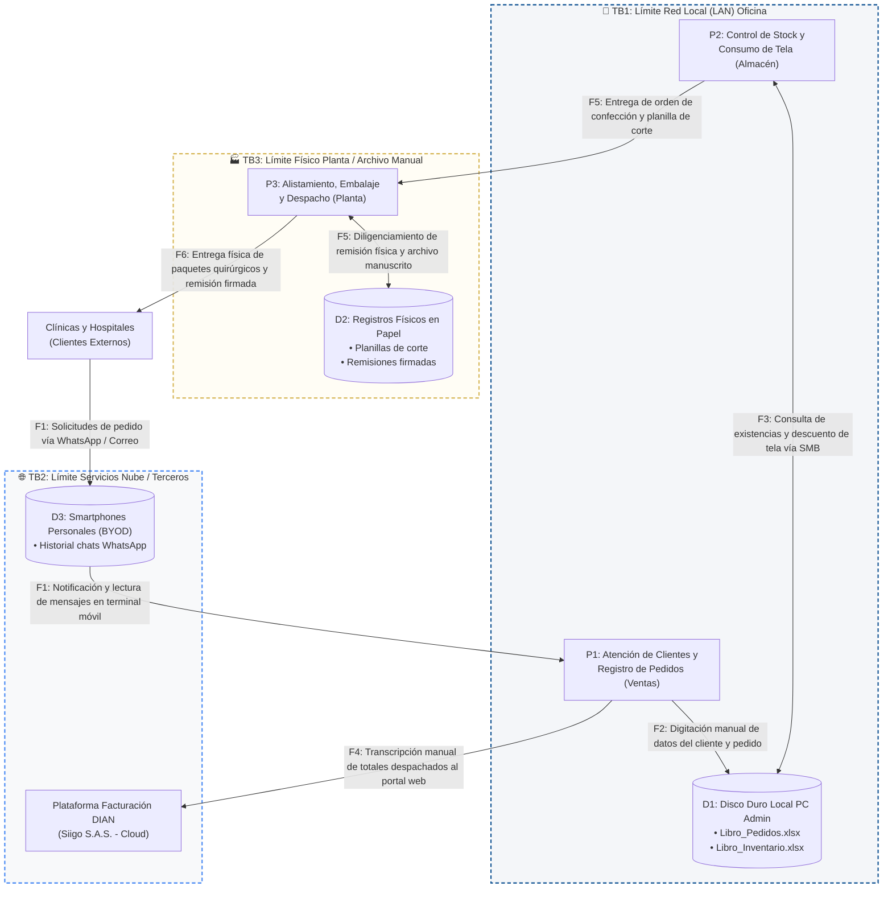

# 📄 Informe Técnico del Taller

## 🔖 Nombre del Taller
Taller 5 - Evaluación de Seguridad con STRIDE aplicado a Insuclínicos Ltda.

## 👥 Integrantes del equipo
* Jorge Steven Doncel (gevengood)
* David Santiago Buendia Londoño (Santiagoob7)

## 🧠 Descripción general del trabajo
El objetivo de este taller fue aplicar el marco de modelado de amenazas **STRIDE** (Spoofing, Tampering, Repudiation, Information Disclosure, Denial of Service y Elevation of Privilege) para evaluar exhaustivamente la seguridad técnica y operativa de la arquitectura actual (AS-IS) de Insuclínicos Ltda. El análisis se concentró en el macro-proceso crítico de **Gestión y Cumplimiento de Pedido**, abarcando la interacción comercial con las clínicas vía WhatsApp, el almacenamiento de datos en hojas de cálculo locales de Microsoft Excel en red compartida (SMB) y los flujos manuales de despacho en planta física.

A través de este ejercicio, se identificaron vulnerabilidades estructurales en la integridad de los datos, el control de acceso y la continuidad del negocio, formulando mitigaciones pragmáticas y proporcionales a las dimensiones de una microempresa manufacturera.

---

## 🔧 Proceso de desarrollo y Metodología

El modelado y evaluación de seguridad se ejecutó en cinco fases articuladas:

1. **Delimitación del Alcance Operativo:** Se definió el perímetro del sistema actual considerando tanto los componentes digitales locales (PC Administración, PC Almacén, disco duro con libros de Excel) como los canales de terceros (Meta WhatsApp, plataforma de facturación electrónica Siigo S.A.S.) y los soportes físicos de manufactura (remisiones de despacho en papel).
2. **Construcción del Diagrama de Flujo de Datos (DFD) con Límites de Confianza:** Se diseñó un DFD representativo que modela los actores externos (Clínicas), los procesos internos (Atención comercial, Control de inventario en Excel, Despacho en planta), los almacenes de datos y los flujos de información (F1 a F6), estableciendo tres **límites de confianza (Trust Boundaries)** claramente diferenciados:
   - *Límite de Red Local (LAN Oficina):* Protege los equipos de cómputo y el almacenamiento en disco local C:\.
   - *Límite de Servicios Nube / Terceros:* Delimita la infraestructura de Meta y Siigo que opera fuera del control directo de la empresa.
   - *Límite Físico de Planta / Archivo:* Delimita el taller de confección y los registros manuscritos en papel.
3. **Evidenciación y Fuentes de los Controles Existentes:** 
   Para garantizar que la columna "Controles de Seguridad Existentes" se fundamente en hechos reales y no en suposiciones, las evidencias se recolectaron a través de dos fuentes primarias:
   - **Entrevista técnica estructurada con el Representante Legal (Santiago Martínez):** Se constató la inexistencia de perfiles diferenciados de usuario en Windows, la ausencia de acuerdos de confidencialidad (NDA) con los operarios y el uso de líneas celulares personales (BYOD) sin gestión corporativa.
   - **Inspección técnica directa en las instalaciones de Bogotá:** Se verificó la ausencia de contraseñas de protección en los libros `.xlsx`, el acceso total (permisos Everyone) en la carpeta de red compartida por SMB, y la falta de mecanismos de respaldo automatizado en la nube (la empresa depende de copias esporádicas en memorias USB).
   - **Reconocimiento Pasivo Externo:** Se inspeccionó el perfil público de WhatsApp Business de la empresa y la interfaz web HTTPS de Siigo, validando que el canal móvil no cuenta con verificación en dos pasos corporativa y que la emisión fiscal depende exclusivamente de transcripción humana.
4. **Identificación y Expansión de Amenazas (8 Escenarios STRIDE):** Se estructuraron 8 amenazas concretas, cubriendo las 6 categorías del marco más dos vectores críticos identificados en la retroalimentación: la fuga y pérdida de pedidos por el uso de WhatsApp en dispositivos personales (T7) y el deterioro o alteración de remisiones físicas en la planta de producción (T8).
5. **Evaluación de Riesgo y Priorización:** Se evaluó el Impacto y la Probabilidad de cada amenaza con criterios homogéneos, catalogando como riesgos **Altos** aquellos que comprometen la continuidad operativa (DoS por daño del disco SPOF), la integridad del inventario (Tampering en Excel), la confidencialidad de la cartera comercial (fuga por USB o celulares BYOD) y la trazabilidad de cotizaciones.

---

## 📈 Diagrama de Flujo de Datos (DFD) con Límites de Confianza

---

## 📋 Matriz de Amenazas STRIDE Evaluada (Insuclínicos Ltda.)

> **Nota metodológica de alineación:** Esta tabla coincide al 100% en identificadores, niveles de riesgo, descripciones y controles con el archivo de trabajo [`tabla-stride-cliente.xlsx`](./tabla-stride-cliente.xlsx), garantizando una única fuente de verdad técnica.

| ID | Componente / Activo | Tipo STRIDE | Descripción de la Amenaza | Escenario de Ataque | Impacto | Probabilidad | Nivel de Riesgo | Controles Existentes (Fuente Verificada) | Mitigación Recomendada | Responsable | Estado |
|:--:|:---|:---:|:---|:---|:---:|:---:|:---:|:---|:---|:---:|:---:|
| **T1** | PC Administración / P1 (Usuarios) | **Spoofing** | Un operario o empleado administrativo utiliza el equipo de otro usuario que dejó su sesión abierta para registrar o alterar pedidos. | Un empleado aprovecha que el PC de Administración está desbloqueado, ingresa un pedido falso o aprueba una salida de inventario a nombre del usuario original. | Medio — Pérdida de integridad en el registro de pedidos e inventario. | Media | **Medio** | Ausencia de políticas de bloqueo de pantalla; sesiones de Windows compartidas sin perfiles individuales *(Fuente: Entrevista Santiago Martínez)*. | Implementar usuarios individuales en Windows con contraseña y políticas de bloqueo automático por inactividad. | Administración | En análisis |
| **T2** | D1 (Disco Duro Local - Archivos Excel) | **Tampering** | Modificación accidental o intencionada de fórmulas, celdas críticas o registros históricos en el Libro de Pedidos o Inventario. | Un usuario sobrescribe por error una celda que contiene la fórmula de cálculo de stock de tela quirúrgica, corrompiendo el inventario. | Alto — Descuadre de inventario, detención de la producción por falsos faltantes. | Alta | **Alto** | Los archivos Excel no tienen protección de celdas ni bloqueo de estructura *(Fuente: Inspección directa en equipo)*. | Proteger celdas con fórmulas en Excel mediante contraseña y migrar los archivos a un entorno colaborativo o base de datos centralizada. | Equipo de Arquitectura | Pendiente |
| **T3** | P2 / D1 (Control de Inventario en Excel) | **Repudiation** | Un usuario reduce o modifica las cantidades de materia prima disponible y posteriormente niega haberlo hecho. | Se detecta un faltante crítico de tela quirúrgica. Al revisar el Excel, se nota una reducción manual del stock, pero nadie asume la responsabilidad porque no hay registro de autoría. | Medio — Dificulta la auditoría interna y el control de mermas/desperdicios de confección. | Alta | **Medio** | El archivo local en el disco duro no guarda historial de versiones ni registro de quién modificó qué celda *(Fuente: Inspección técnica)*. | Habilitar el control de cambios en Excel y alojar el archivo en repositorio centralizado con bitácora de auditoría inmutable. | Administración | En progreso |
| **T4** | D1 (Archivos Excel en Red Local) | **Information Disclosure** | Exposición y fuga no autorizada de la base de clientes corporativos y listas de precios confidenciales mediante copias locales. | Un empleado o externo copia el archivo Excel con la cartera de clínicas a una memoria USB para compartirlo con un competidor. | Alto — Fuga de información comercial sensible y pérdida de ventaja competitiva. | Media | **Alto** | No hay restricciones de puertos USB en Windows ni políticas de confidencialidad firmadas *(Fuente: Entrevista Santiago Martínez)*. | Deshabilitar puertos USB mediante políticas de grupo (GPO) en Windows y firmar acuerdos de confidencialidad (NDA). | Infraestructura / Legal | Pendiente |
| **T5** | D1 (Disco Duro Local PC Administración - SPOF) | **Denial of Service** | Pérdida total de acceso a la información operativa por fallo físico del disco duro o ataque de ransomware. | Un ransomware infecta el PC de Administración o el disco duro sufre un fallo mecánico, encriptando o destruyendo el único registro de pedidos e inventario. | Alto — Paralización completa de la producción, despachos y facturación. | Media | **Alto** | Punto único de falla físico sin redundancia y sin copias de seguridad formales en la nube *(Fuente: Diagnóstico de infraestructura)*. | Implementar política de backups automatizados diarios en la nube siguiendo la regla 3-2-1. | Infraestructura | Pendiente |
| **T6** | D1 / F3 (Recurso Compartido en Red Local SMB) | **Elevation of Privilege** | Acceso de usuarios de producción a información financiera o de facturación restringida a la administración. | Al compartir la carpeta en red para que Producción consulte los pedidos, un operario navega hacia la subcarpeta de facturación electrónica y accede a datos contables. | Medio — Exposición interna de datos financieros no correspondientes a las funciones del rol. | Alta | **Medio** | Carpetas compartidas en red local con permisos de control total (Lectura/Escritura) para Todos (Everyone) *(Fuente: Inspección de red)*. | Configurar Control de Acceso Basado en Roles (RBAC) a nivel de sistema de archivos (NTFS), restringiendo el acceso por carpetas según el perfil. | Equipo de Seguridad | En análisis |
| **T7** | D3 / F1 (Smartphones Personales BYOD / WhatsApp) | **Information Disclosure** | Fuga de datos de clientes, pérdida de cotizaciones comerciales o suplantación por pérdida o uso no corporativo de móviles personales. | Un vendedor pierde su smartphone personal sin bloqueo biométrico, o un tercero accede a chats comerciales con clínicas con datos de facturación. | Alto — Exposición de datos personales protegidos (Ley 1581) y fuga de cotizaciones comerciales estratégicas. | Alta | **Alto** | Atención por WhatsApp desde líneas móviles personales sin gestión corporativa ni respaldo institucional *(Fuente: Reconocimiento pasivo del canal)*. | Migrar a una cuenta corporativa oficial de WhatsApp Business API vinculada a un conmutador/buzón centralizado y definir política BYOD. | Gerencia / Comercial | Pendiente |
| **T8** | D2 / F5 (Registros Físicos en Papel en Planta) | **Tampering** | Pérdida física, deterioro accidental por tintas/aceites o adulteración manuscrita de planillas de corte y remisiones de entrega. | Una planilla de corte con el número de lote de tela SMS se traspapela o se mancha en el taller, impidiendo verificar el cumplimiento del lote ante un reclamo hospitalario. | Medio — Pérdida de trazabilidad sanitaria obligatoria según Decreto 4725 de 2005 del INVIMA. | Media | **Medio** | Archivo físico en archivadores de cartón sin control de acceso ni digitalización de respaldo *(Fuente: Inspección visual en planta)*. | Estandarizar el registro digital del número de lote desde la orden de pedido y digitalizar mediante escaneo fotográfico las remisiones firmadas. | Producción / Calidad | En análisis |

---

## 🔍 Investigación complementaria

**Tema investigado:** Estrategias de ciberseguridad pragmáticas y mitigación de amenazas STRIDE en microempresas manufactureras con alta dependencia de TI en la sombra (*Shadow IT*).

**Resumen:**
En organizaciones manufactureras de escala micro (menos de 10 empleados), la ciberseguridad no suele gestionarse mediante firewalls de última generación o centros de operaciones de seguridad (SOC). Los procesos de negocio dependen críticamente de soluciones ofimáticas improvisadas por los empleados (*Shadow IT*), tales como libros de Excel compartidos en red y teléfonos personales para atención al cliente.

La literatura especializada (NIST Small Business Cybersecurity Guidelines y CISA Insights, 2023) enfatiza que aplicar STRIDE a estos entornos requiere enfocar el análisis en la **higiene digital fundamental**:
1. **Priorización de la Disponibilidad y la Integridad:** El mayor impacto destructivo proviene de la **Denegación de Servicio (T5)** y la **Alteración de Datos (T2)**. Si el único disco duro que contiene la cartera de pedidos falla mecánicamente o es cifrado por ransomware, la empresa se paraliza de inmediato. La mitigación prioritaria consiste en adoptar la **regla de respaldo 3-2-1** (tres copias de los datos, dos tipos de soporte distintos y una copia externa cifrada en la nube).
2. **Control de Acceso Básico (PoLP y RBAC):** La mitigación de amenazas como **Suplantación (T1)** y **Elevación de Privilegios (T6)** no exige licencias corporativas costosas; puede resolverse configurando perfiles individuales protegidos por contraseña en Windows 11 y restringiendo los permisos NTFS de las carpetas compartidas para que los operarios de almacén solo tengan acceso de lectura a los libros necesarios.
3. **Gobierno de Canales Móviles (BYOD):** La incorporación de la amenaza **T7** valida las recomendaciones de MinTIC (2023): permitir que el personal comercial maneje pedidos sensibles desde sus celulares personales sin acuerdos de confidencialidad ni copias institucionales vulnera la Ley de Protección de Datos Personales (Ley 1581 de 2012) y deja a la empresa desprotegida ante la desvinculación laboral de un colaborador.

---

## 📚 Referencias
* [1] Microsoft Corporation. (2022). *The STRIDE Threat Model*. Microsoft Security Engineering Guide. https://learn.microsoft.com/en-us/azure/security/develop/threat-modeling-tool-threats
* [2] Cybersecurity and Infrastructure Security Agency — CISA. (2023). *Data Backup Options and the 3-2-1 Rule for Small Business Resilience*. CISA Insights. https://www.cisa.gov/resources-tools/resources/data-backup-options
* [3] National Institute of Standards and Technology — NIST. (2021). *Small Business Information Security: The Fundamentals (NIST SP 800-184 / Small Business Guide)*. U.S. Department of Commerce. https://www.nist.gov/itl/smallbusinesscyber
* [4] Ministerio de Tecnologías de la Información y las Comunicaciones — MinTIC. (2023). *Guía de Ciberseguridad y Respaldo de Información para Micro, Pequeñas y Medianas Empresas en Colombia*. https://www.mintic.gov.co/
* [5] OWASP Foundation. (2021). *OWASP Top 10: The Ten Most Critical Security Risks*. https://owasp.org/Top10/
* [6] Insuclínicos Ltda. (2026). *Entrevista técnica operativa con Santiago Martínez (Representante Legal) y Ficha de Caracterización*. Archivo de campo Grupo 8 AREM.
