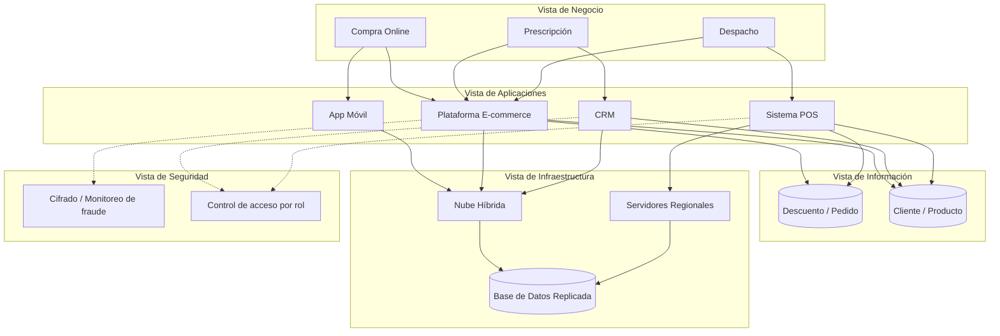

# 🗒️ Registro de Trabajo en Clase - Taller 8

## 📆 Fecha de la sesión
9 de noviembre de 2026.

## 👥 Integrantes presentes
- Jorge Steven Doncel Bejarano (`@gevengood`)
- David Santiago Buendia Londoño (`@Santiagoob7`)

---

## 🧠 Actividades realizadas en clase

- Se revisó la [`guia_paso_a_paso_integracion.md`](https://github.com/CesarAVegaF312/AREM-Taller_8_Integracion_Vistas/blob/main/clase/guia_paso_a_paso_integracion.md) y el tablero interactivo de referencia (`visualizacion-integracion-vistas.html`) para comprender la metodología de 5 pasos aplicada al caso base **FarmApp (Cadena de Farmacias con E-Commerce)**.
- **Decisiones de modelado sobre FarmApp:**
  1. Se organizaron las **5 capas** de arriba hacia abajo (`Negocio` → `Aplicaciones` → `Información` → `Infraestructura` → `Seguridad`) sin omitir ninguno de los 17 elementos base del caso.
  2. Se construyó primero la vista de **Paso 2 (Capas sueltas)** en la primera pestaña del diagrama, ubicando los 3 procesos de negocio, 4 aplicaciones, 4 entidades de información, 3 nodos de infraestructura y 3 controles de seguridad sin flechas todavía.
  3. Se trazaron las relaciones verticales en la segunda pestaña (**Paso 3 — Tablero Integrado**) comenzando por el hilo principal **Compra Online** (en azul/rojo, idéntico a la guía) y completando luego los hilos de **Prescripción** (en verde) y **Despacho** (en morado) para que ninguno de los 17 elementos quedara huérfano.
  4. Se identificó el patrón de error típico mostrado en el modelo de práctica (`farmapp-modelo-integrado.xml`), donde un mismo componente aparece duplicado por un cambio tipográfico (*«Plataforma E-commerce»* vs. *«Plataforma Ecommerce»*), dejando desconectada la capa de aplicaciones respecto a infraestructura.
- **Herramientas utilizadas:** draw.io (`tablero-farmapp.drawio` con dos pestañas: Paso 2 y Paso 3), Markdown/Mermaid para documentación y verificación contra la lista de huérfanos de la guía.

---

## 🧩 Boceto y verificación del modelo de FarmApp (Pasos 4 y 5)

### Narrativa de coherencia del caso base (Paso 4)
- **Hilo 1 — Compra Online:** Se apoya en la *Plataforma E-commerce* y la *App Móvil* porque la mayor parte de la demanda digital llega desde dispositivos móviles. Ambos canales leen y escriben sobre las mismas entidades (*Producto*, *Cliente*, *Pedido*, *Descuento*) para evitar quiebres de inventario entre canal web y app. Corren sobre *Nube Híbrida* con *Base de Datos Replicada* para absorber picos promocionales, y aplican *Cifrado de datos personales* y *Monitoreo de fraude* al procesar pagos electrónicos en línea.
- **Hilo 2 — Prescripción:** Conecta el proceso médico con el *CRM* y la *Plataforma E-commerce* para validar historial del *Cliente* y disponibilidad del *Producto* farmacéutico, alojado en *Nube Híbrida* bajo *Cifrado de datos personales* y *Control de acceso por rol* por tratarse de fórmulas médicas sensibles.
- **Hilo 3 — Despacho:** Conecta la entrega física con el *Sistema POS* (puntos físicos) y la *Plataforma E-commerce*, actualizando *Pedido* y descontando *Producto* sobre *Servidores Regionales* sincronizados con la *Base de Datos Replicada*, protegidos mediante *Control de acceso por rol*.

### Verificación de consistencia (Paso 5)
- **Corte parcial (solo Hilo Compra Online):** 11 elementos conectados y 6 elementos pendientes (*Prescripción*, *Despacho*, *Sistema POS*, *CRM*, *Servidores Regionales*, *Control de acceso por rol*), lo cual es esperado antes de trazar los demás hilos.
- **Tablero completo (3 Hilos trazados en `tablero-farmapp.drawio`):** **17 de 17 elementos conectados** con trazabilidad vertical hacia arriba y hacia abajo; **0 huérfanos**.

- **Diagrama digital en draw.io:** [`tablero-farmapp.drawio`](tablero-farmapp.drawio)

---

## 🔁 Tareas definidas para complementar el taller (Parte 2 — Cliente Real)

| Tarea asignada | Responsable | Estado |
|---|---|---|
| Mapear el inventario completo AS-IS + TO-BE (`NUEVO`) de Insuclínicos Ltda. en 5 capas | Jorge & David Santiago | Completado en `tablero-integrado-cliente.drawio` |
| Trazar los 3 hilos de negocio de Insuclínicos y verificar consistencia/huérfanos | David Santiago & Jorge | Completado en `tablero-integrado-cliente.drawio` |
| Redactar narrativa de coherencia, tabla de verificación e investigación complementaria | Jorge & David Santiago | Completado en `../informe.md` |
| Consolidar fuentes primarias y validar formato APA en referencias | David Santiago | Completado en `../referencias.md` |

---

*Este documento resume el trabajo colaborativo realizado durante la sesión del Taller 8 en el curso AREM — Universidad de La Sabana.*
