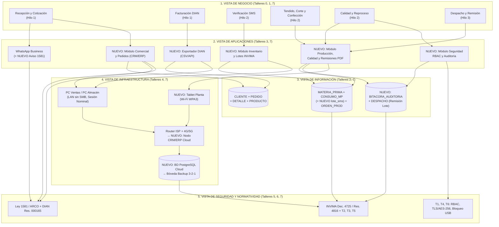

# 📄 Informe Técnico del Taller

## 🔖 Nombre del Taller
Taller 8 — Integración de Vistas de Arquitectura (AS-IS y TO-BE aplicados a Insuclínicos Ltda.)

## 👥 Integrantes del equipo (Grupo 8)
- **Jorge Steven Doncel Bejarano** — Código: 282296 · GitHub: [`@gevengood`](https://github.com/gevengood) · Correo: [jorgedobe@unisabana.edu.co](mailto:jorgedobe@unisabana.edu.co)
- **David Santiago Buendia Londoño** — Código: 306487 · GitHub: [`@Santiagoob7`](https://github.com/Santiagoob7) · Correo: [davidbulo@unisabana.edu.co](mailto:davidbulo@unisabana.edu.co)

---

## 🧠 Descripción general del trabajo

El objetivo del **Taller 8** fue integrar en un único tablero arquitectónico coherente todas las vistas desarrolladas durante el semestre para nuestro cliente real, **Insuclínicos Ltda.** (empresa bogotana de 6 trabajadores dedicada a la confección y comercialización de prendas e insumos médicos desechables en tela quirúrgica SMS para ~40 clínicas, consultorios y spas).

A diferencia de los talleres anteriores —donde cada capa se analizó por separado—, este entregable articula de manera vertical el estado actual (**AS-IS**) levantado en los Talleres 1 a 6 junto con la arquitectura objetivo (**TO-BE**) diseñada en el Taller 7:

- **Vista de Negocio:** Macro-proceso *Gestión y Cumplimiento de Pedido* y subproceso de *Producción* (Talleres 0 y 1 BPMN) más las mejoras de proceso TO-BE (Taller 7).
- **Vista de Aplicaciones:** Ecosistema ofimático actual y sistemas externos (Taller 3 C2) junto a los módulos **`NUEVO`** del CRM/ERP ligero en la nube y el exportador de facturación (Taller 7).
- **Vista de Información:** Las 8 entidades del modelo entidad-relación (Taller 2 ER) extendidas con atributos de trazabilidad sanitaria INVIMA, consentimiento Ley 1581 y la entidad **`NUEVO`** de bitácora de auditoría (Taller 7).
- **Vista de Infraestructura:** Mapa de 3 zonas LAN/Nube/Planta y su Punto Único de Falla AS-IS (Taller 4) frente a la infraestructura gestionada en nube y la Tablet de planta **`NUEVO`** (Taller 7).
- **Vista de Seguridad y Cumplimiento Normativo:** Amenazas STRIDE `T1`–`T6` (Taller 5) y restricciones de Ley 1581, INVIMA (Decreto 4725/2005 y Resolución 4816/2008), DIAN (Resolución 000165/2023) e ISO/IEC 27001:2022 (Taller 6), materializadas en controles concretos del TO-BE.

En la Parte 1 se practicó previamente la metodología de 5 pasos sobre el caso base **FarmApp** (ver [`clase/notas.md`](clase/notas.md) y [`clase/tablero-farmapp.drawio`](clase/tablero-farmapp.drawio)). En esta Parte 2 se consolidó la integración completa para Insuclínicos Ltda.

---

## 🔧 Proceso de desarrollo (Metodología en 5 pasos)

Siguiendo estrictamente la guía del curso, la integración se construyó en cinco pasos secuenciales:

1. **Paso 1 — Organizar las vistas en 5 capas:** Se dispusieron cinco bandas horizontales superpuestas de arriba hacia abajo: `1. Negocio` → `2. Aplicaciones` → `3. Información` → `4. Infraestructura` → `5. Seguridad y Normatividad`. Se incluyó el cumplimiento normativo dentro de la quinta capa porque en Insuclínicos las decisiones de seguridad técnica (STRIDE) y las restricciones regulatorias (INVIMA y Ley 1581) condicionan directamente la misma arquitectura de datos y aplicaciones.
2. **Paso 2 — Ubicar los elementos AS-IS y TO-BE sin conectar (Pestaña 1 del diagrama):** Se inventariaron todos los elementos provenientes de los Talleres 1 a 7 conservando exactamente sus nombres originales para garantizar trazabilidad nominal (evitando duplicados por renombramiento). Se aplicó codificación visual explícita: **verde (`NUEVO`)** para elementos TO-BE del Taller 7, **azul/gris** para elementos conservados o endurecidos, y **rojo punteado** para los 4 activos AS-IS reemplazados/retirados (*Libro de Pedidos Excel*, *Libro de Inventario Excel*, *Registros en Papel* y *Disco Duro Local SPOF*).
3. **Paso 3 — Trazar relaciones verticales por hilo de negocio (Pestaña 2 del diagrama):** Para evitar un diagrama ilegible, se trazaron **tres hilos de negocio completos** de punta a punta a través de las cinco capas sobre la arquitectura objetivo integrada, más dos enlaces de transición que documentan explícitamente qué componente `NUEVO` absorbe y retira al legado AS-IS:
   - **Hilo 1 (Azul): Gestión Comercial y Facturación Electrónica.**
   - **Hilo 2 (Verde): Control de Inventario SMS, Producción y Trazabilidad INVIMA.**
   - **Hilo 3 (Morado): Despacho con Remisión Digital y Continuidad Operativa (Backup 3-2-1).**
4. **Paso 4 — Redactar la narrativa de coherencia:** Se documentó el razonamiento arquitectónico detrás de cada cadena de conexiones (ver sección siguiente), justificando *por qué* esas piezas se conectan así a partir de las restricciones de presupuesto PyME (`~$2.2M COP/año`), los riesgos STRIDE y las obligaciones legales.
5. **Paso 5 — Revisar consistencia y elementos huérfanos:** Se auditó cada elemento capa por capa mediante una tabla formal de conexión hacia arriba y hacia abajo, verificando que los únicos elementos desconectados de la operación TO-BE correspondan exclusivamente a los 4 activos legados AS-IS cuyo retiro está explícitamente trazado y justificado.

---

## 🧩 Análisis del modelo propuesto y Narrativa de Coherencia (Paso 4)

### 1. Cómo se estructura el modelo entregado

El tablero [`tablero-integrado-cliente.drawio`](tablero-integrado-cliente.drawio) cuenta con dos vistas complementarias en draw.io:
- **Vista 1 (`1. Inventario 5 Capas (AS-IS y TO-BE)`):** Foto comparativa de transición que reúne los **40 elementos individuales** consolidados del semestre en sus cinco capas (6 de Negocio, 10 de Aplicaciones, 9 de Información, 8 de Infraestructura y 7 de Seguridad/Norma), diferenciando lo que permanece, los **4 activos legados AS-IS** que se retiran del *Shadow IT* y lo que entra como **`NUEVO`**.
- **Vista 2 (`2. Hilos Conectados End-to-End`):** Grafo integrado de **34 nodos y 37 relaciones** (agrupando únicamente por legibilidad `PEDIDO & DETALLE`, `Exportador + Portal DIAN`, `T1/T4/T6` y la caja resumen de aplicaciones legadas retiradas) donde cada proceso de negocio se conecta verticalmente hacia sus módulos de aplicación, entidades de datos, nodos físicos/cloud y controles de seguridad/norma.

### 2. Narrativa de coherencia: el *porqué* de las conexiones clave

#### Hilo 1 — Gestión Comercial y Facturación Electrónica (Cierra `GAP-01`, `GAP-02`, `GAP-10`)
El proceso de **Recepción y Cotización de Pedido** nace hoy en **WhatsApp Business** (preferido por las ~40 clínicas y spas por su inmediatez), por lo que en vez de reemplazar el canal comercial se integra un aviso automático de privacidad (**Ley 1581 / Dec. 1377**) en el saludo inicial. A continuación, el rol de Ventas registra la solicitud en el **`NUEVO` Módulo Comercial y Pedidos** del CRM/ERP ligero (Odoo/Dolibarr Cloud) en lugar del antiguo *Libro de Pedidos Excel*. Esta decisión tomada en la matriz ponderada del Taller 7 se justifica porque Ventas necesita consultar en vivo las entidades `CLIENTE` (con casilla obligatoria `consentimiento_ley1581`), `PEDIDO`, `DETALLE_PEDIDO` y `PRODUCTO` sin sufrir los 2–3 bloqueos diarios de *"Solo lectura"* diagnosticados en la red local del Taller 4.

El flujo comercial opera desde el **PC Ventas / Administración** mediante navegador HTTPS sobre el **Router ISP** hacia el **`NUEVO` Nodo CRM/ERP Cloud** y la **`NUEVO` BD PostgreSQL Gestionada**, cerrando simultáneamente dos riesgos STRIDE del Taller 5: se exige sesión nominal y bloqueo a los 5 minutos (`T1`) y se deshabilita la copia masiva de la cartera de clientes por puertos USB (`T4`). Al cierre de la venta, el proceso de **Facturación Electrónica** se conecta con el **`NUEVO` Exportador / Conector DIAN (CSV/API)** que extrae el pedido aprobado de `PEDIDO` hacia la **Plataforma de Facturación Electrónica**, suprimiendo la doble digitación manual que consumía ~6 horas semanales y preservando el cumplimiento tributario de la **Resolución DIAN 000165 de 2023**.

#### Hilo 2 — Control de Inventario SMS, Producción y Trazabilidad INVIMA (Cierra `GAP-04`, `GAP-05`, `GAP-07`, `GAP-09`)
En el Taller 1 (BPMN) se evidenció que el subproceso de producción se frena en el gateway *«¿Hay material suficiente?»* por descuadres entre el Excel de inventario y la bodega física, y en el gateway *«¿Cumple especificaciones?»* por reprocesos sin registro digital. En el tablero integrado, **Verificación de Material SMS** se apoya en el **`NUEVO` Módulo Inventario y Lotes INVIMA**, mientras que **Tendido, Corte y Confección** e **Inspección de Calidad** se conectan al **`NUEVO` Módulo Producción, Calidad y Remisiones** y al **`NUEVO` Módulo Seguridad RBAC y Auditoría**.

Esta conexión transversal explica el corazón regulatorio y técnico de la propuesta: cuando Almacén registra un rollo en `MATERIA_PRIMA` desde el **PC Almacén** (ya sin carpetas compartidas SMB abiertas, mitigando `T6`) y el operario en planta consulta la `ORDEN_PRODUCCION` en la **`NUEVO` Tablet / Terminal Web en Planta** (conectada por Wi-Fi WPA3), el sistema exige asociar el campo **`NUEVO` `lote_sms_invima`** en `CONSUMO_MATERIA_PRIMA` antes de permitir cerrar la orden. Así se cumple la trazabilidad bidireccional obligatoria exigida por el **INVIMA (Decreto 4725 de 2005 y Resolución 4816 de 2008)** para dispositivos médicos Clase I. Al mismo tiempo, las reglas de negocio en servidor impiden que el rol de planta altere precios o fórmulas (`T2`) y cada descuento de stock queda registrado en **`NUEVO` `BITACORA_AUDITORIA`** (`T3`, ISO 27001 A.8.15), resolviendo la falta de autoría en mermas de tela SMS.

#### Hilo 3 — Despacho con Remisión Digital y Continuidad Operativa (Cierra `GAP-03`, `GAP-05`, `GAP-08`, `GAP-09`)
El proceso de **Despacho y Remisión a Clínica** consume el **`NUEVO` Módulo Producción, Calidad y Remisiones** para emitir el registro en la entidad `DESPACHO` (donde `numero_remision` estampa automáticamente el lote del rollo SMS utilizado, habilitando un *recall* sanitario en minutos en lugar de buscar planillas físicas). En la capa de infraestructura, toda la información consolidada en la **`NUEVO` BD PostgreSQL Gestionada (Multi-AZ + AES-256)** reemplaza definitivamente al **`Disco Duro Local (Archivos Excel) [SPOF AS-IS]`** del Taller 4 y ejecuta automáticamente copias diarias hacia la **`NUEVO` Bóveda Backup 3-2-1 Inmutable** a las 11:00 PM. Esta última conexión materializa el control contra **Denegación de Servicio (`T5`)** y *ransomware* (ISO 27001 A.8.13) sin obligar a los 6 empleados a recordar respaldos manuales en memorias USB.

### 3. Supuestos tomados en la integración
1. **Convivencia temporal en la transición (`WP1` → `WP2` → `WP3`):** Aunque el tablero integrado muestra el estado objetivo conectado sobre los 3 paquetes de trabajo del Taller 7, durante las Semanas 1–2 (`WP1`) los libros Excel permanecen transitoriamente con respaldo en nube 3-2-1 y cuentas nominales Windows hasta completar el corte hacia PostgreSQL en la Semana 8 (`WP2`).
2. **Unificación de plataforma CRM/ERP:** Se modela la aplicación web (Odoo o Dolibarr Cloud) desglosada en 4 módulos funcionales y 1 conector para mantener trazabilidad directa con los contenedores del Taller 3 y las brechas del Taller 7, aunque físicamente corran dentro de un mismo nodo PaaS Linux.
3. **Contingencia de conectividad:** Al trasladar la persistencia de LAN local a la nube, la disponibilidad depende del enlace de internet de la sede única en Bogotá; por ello la capa de infraestructura incluye explícitamente respaldo con datos móviles 4G/5G en el *Router/Gateway*.

---

## ✅ Revisión de Consistencia y Verificación de Huérfanos (Paso 5)

Siguiendo el Paso 5 de la guía, se verificó que cada elemento del tablero integrado tenga conexión hacia la capa superior y hacia la capa inferior (exceptuando Negocio como capa más alta, y Seguridad/Norma como capa de cierre transversal):

| Elemento del Tablero | Capa | ¿Conectado hacia arriba? | ¿Conectado hacia abajo? | Estado y Justificación |
|---|---|---|---|---|
| **Recepción y Cotización de Pedido** | Negocio | — *(capa más alta)* | Sí (`WhatsApp Business`, `Módulo Comercial`) | Conectado (Hilo 1) |
| **Facturación Electrónica y Cobro** | Negocio | — *(capa más alta)* | Sí (`Exportador DIAN`) | Conectado (Hilo 1) |
| **Verificación Material SMS y Compras** | Negocio | — *(capa más alta)* | Sí (`Módulo Inventario y Lotes`) | Conectado (Hilo 2) |
| **Tendido, Corte y Confección** | Negocio | — *(capa más alta)* | Sí (`Módulo Producción, Calidad y Remisiones`) | Conectado (Hilo 2) |
| **Inspección de Calidad y Reproceso** | Negocio | — *(capa más alta)* | Sí (`Módulo Producción`, `Módulo Seguridad`) | Conectado (Hilo 2) |
| **Despacho y Remisión a Clínica** | Negocio | — *(capa más alta)* | Sí (`Módulo Producción/Remisiones`) | Conectado (Hilo 3) |
| **WhatsApp Business / Correo** | Aplicaciones | Sí (`Recepción y Cotización`) | Sí (`Ley 1581 / ARCO`) | Conectado (Hilo 1) |
| **`NUEVO` Módulo Comercial y Pedidos** | Aplicaciones | Sí (`Recepción y Cotización`) | Sí (`CLIENTE`, `PEDIDO`, `PRODUCTO`, `PC Ventas`, `Ley 1581`) | Conectado (Hilo 1) |
| **`NUEVO` Exportador / Conector DIAN + Portal DIAN** | Aplicaciones | Sí (`Facturación Electrónica`) | Sí (`PEDIDO`, `DIAN Res. 000165`) | Conectado (Hilo 1) |
| **`NUEVO` Módulo Inventario y Lotes INVIMA** | Aplicaciones | Sí (`Verificación SMS`) | Sí (`MATERIA_PRIMA`, `CONSUMO_MP`, `PC Almacén`) | Conectado (Hilo 2) |
| **`NUEVO` Módulo Producción, Calidad y Remisiones** | Aplicaciones | Sí (`Producción`, `Calidad`, `Despacho`) | Sí (`ORDEN_PRODUCCION`, `DESPACHO`, `Tablet Planta`) | Conectado (Hilos 2 y 3) |
| **`NUEVO` Módulo Seguridad RBAC y Auditoría** | Aplicaciones | Sí (`Inspección Calidad`) | Sí (`BITACORA_AUDITORIA`, `T1/T4/T6 RBAC`, `T2/T3 Logs`) | Conectado (Hilo 2) |
| **`CLIENTE`, `PEDIDO`, `DETALLE_PEDIDO`, `PRODUCTO`** | Información | Sí (`Módulo Comercial`, `Exportador DIAN`) | Sí *(vía App → Infraestructura y hacia `Ley 1581`)* | Conectado (Hilo 1) |
| **`MATERIA_PRIMA`, `CONSUMO_MP`, `ORDEN_PRODUCCION`** | Información | Sí (`Módulo Inventario`, `Módulo Producción`) | Sí (`INVIMA Dec. 4725 / Res. 4816`) | Conectado (Hilo 2) |
| **`DESPACHO`** | Información | Sí (`Módulo Producción/Remisiones`) | Sí (`INVIMA Lote impreso`) | Conectado (Hilo 3) |
| **`NUEVO` `BITACORA_AUDITORIA`** | Información | Sí (`Módulo Seguridad RBAC`) | Sí (`T2 & T3 Logs inmutables`) | Conectado (Hilo 2) |
| **PC Ventas / PC Almacén / Router WPA3** | Infraestructura | Sí (`Módulo Comercial`, `Módulo Inventario`) | Sí (`Nodo CRM/ERP Cloud`) | Conectado (Hilos 1 y 2) |
| **`NUEVO` Tablet / Terminal Web en Planta** | Infraestructura | Sí (`Módulo Producción/Remisiones`) | Sí (`Router Wi-Fi WPA3`) | Conectado (Hilo 2) |
| **`NUEVO` Nodo Aplicación CRM/ERP Cloud** | Infraestructura | Sí (`Router WPA3` ← módulos Web) | Sí (`BD PostgreSQL Cloud`) | Conectado (Hilos 1 y 2) |
| **`NUEVO` BD PostgreSQL Gestionada** | Infraestructura | Sí (`Nodo CRM/ERP Cloud`) | Sí (`Bóveda Backup 3-2-1`) | Conectado (Hilos 1, 2 y 3) |
| **`NUEVO` Bóveda Backup 3-2-1 Inmutable** | Infraestructura | Sí (`BD PostgreSQL Cloud`) | Sí (`T5 & ISO 27001 A.8.13`) | Conectado (Hilo 3) |
| **7 Controles de Seguridad y Normatividad (`T1`–`T6`, Ley 1581, INVIMA, DIAN)** | Seguridad / Norma | Sí *(conectados a módulos, datos e infraestructura)* | — *(capa de cierre)* | Todos conectados |
| **Legado AS-IS: `Libro de Pedidos [Excel]`, `Libro de Inventario [Excel]`, `Planillas Papel`** | Aplicaciones *(Retirados)* | — *(desconectados en operación TO-BE)* | Enlazados por transición de reemplazo hacia Módulos TO-BE | **Huérfano justificado:** retirados en `WP2` y `WP3` |
| **Legado AS-IS: `Disco Duro Local (Excel) [SPOF]`** | Infraestructura *(Retirado)* | — *(desconectado en operación TO-BE)* | Enlazado por transición de migración hacia `BD PostgreSQL Cloud` | **Huérfano justificado:** eliminado en `WP2` |

> **Conclusión de consistencia:** De los **40 elementos individuales** inventariados entre AS-IS y TO-BE en la Vista 1 (representados en **34 nodos** y **37 relaciones** en la Vista 2), **36 elementos (32 nodos) quedan conectados end-to-end** en la operación objetivo y los **4 restantes son activos legados AS-IS cuyo retiro está explícitamente documentado y enlazado a su reemplazo TO-BE**, cumpliendo cero huérfanos sin justificación.

---

## 📈 Diagrama final entregado

- **Tablero integrado del cliente (Insuclínicos Ltda.):** [`tablero-integrado-cliente.drawio`](tablero-integrado-cliente.drawio) *(contiene 2 pestañas: Inventario AS-IS/TO-BE en 5 capas + Hilos conectados End-to-End)*
- **Tablero caso base en clase (FarmApp):** [`clase/tablero-farmapp.drawio`](clase/tablero-farmapp.drawio)

---

## 📋 Tabla consolidada de actores, elementos y trazabilidad entre talleres

| Elemento integrado | Capa | Taller de origen | Responsable |
|---|---|---|---|
| **Gestión y Cumplimiento de Pedido (6 subprocesos)** | Negocio | Talleres 0, 1 y 7 | Ventas, Almacén, Producción, Calidad, Despacho |
| **WhatsApp Business (+ Aviso Ley 1581)** | Aplicaciones | Talleres 3, 6 y 7 | Ventas / Administración |
| **`NUEVO` CRM/ERP Ligero (4 módulos) + Exportador DIAN** | Aplicaciones | Taller 7 (`WP2`, `WP3`) | Proveedor Cloud / Roles internos |
| **Plataforma Facturación Electrónica (DIAN)** | Aplicaciones | Talleres 3 y 6 | Proveedor Tecnológico DIAN |
| **8 Entidades ER + `NUEVO` `BITACORA_AUDITORIA`** | Información | Talleres 2 y 7 | BD PostgreSQL Gestionada |
| **PC Ventas, PC Almacén, Router WPA3** | Infraestructura | Talleres 4 y 7 | Administración / Almacén |
| **`NUEVO` Tablet Planta + Nodo Cloud + PostgreSQL + Backup 3-2-1** | Infraestructura | Taller 7 (`WP1`–`WP3`) | Producción / Proveedor Cloud |
| **Controles STRIDE `T1`–`T6`, Ley 1581, INVIMA Dec. 4725/Res. 4816, DIAN** | Seguridad / Norma | Talleres 5, 6 y 7 | Gerencia (DPO) / Todos los roles |

---

## 🔍 Investigación complementaria

### Tema investigado:
Estándares y buenas prácticas reales para la integración y documentación multi-vista de arquitectura empresarial en PyMEs manufactureras de dispositivos médicos (**ISO/IEC/IEEE 42010**, **ArchiMate 3.2 Layered Viewpoint** e **ISO 13485**).

### Resumen:
La norma internacional **ISO/IEC/IEEE 42010** (*Systems and software engineering — Architecture description*) establece que describir un sistema mediante vistas separadas (negocio, datos, aplicaciones, infraestructura o seguridad) es insuficiente si no se documentan formalmente sus **correspondencias** (*correspondences*) y **reglas de correspondencia** (*correspondence rules*). Según el estándar, las fallas arquitectónicas rara vez ocurren dentro de una vista aislada; emergen en los puntos de cruce donde dos modelos usan nombres distintos, asumen formatos incompatibles o dejan requisitos sin respaldo técnico. Aplicar una matriz de verificación de conexiones arriba/abajo (Paso 5 de este taller) implementa en la práctica el principio de gestión de inconsistencias de la norma ISO/IEC/IEEE 42010.

En la industria de manufactura de escala PyME, la literatura sobre aplicación de **ArchiMate 3.2** (*Layered Viewpoint*) recomienda evitar modelos burocráticos exhaustivos y concentrarse en cadenas verticales de trazabilidad sobre los flujos críticos de valor y cumplimiento regulatorio. Para fabricantes de dispositivos médicos bajo sistemas de gestión de calidad como **ISO 13485:2016** (numeral 7.5.9 de *Identificación y Trazabilidad*) y regulación **INVIMA** en Colombia, documentar explícitamente cómo el proceso de piso de planta se conecta con el componente ERP, el objeto de datos de lote y la infraestructura de respaldo permite responder en minutos ante auditorías de tecnovigilancia o análisis de impacto frente a caídas de hardware. En Insuclínicos Ltda., esta integración vertical demuestra visualmente que el CRM/ERP en la nube y la Tablet de planta no son un gasto aislado de TI, sino el mecanismo estructural que une la operación comercial, el control de tela SMS y el blindaje legal ante INVIMA, SIC y DIAN.

---

## 📚 Referencias

- [1] ISO/IEC/IEEE. (2022). *ISO/IEC/IEEE 42010:2022 — Software, systems and enterprise — Architecture description*. Ginebra: ISO.
- [2] The Open Group. (2022). *ArchiMate® 3.2 Specification — Chapter 14 & Appendix: Layered Viewpoint and Cross-Layer Relationships*.
- [3] The Open Group. (2022). *The TOGAF® Standard, 10th Edition — Architecture Views, Viewpoints, and Stakeholders*.
- [4] International Organization for Standardization (ISO). (2016). *ISO 13485:2016 — Medical devices — Quality management systems — Requirements for regulatory purposes (Section 7.5.9 Traceability)*.
- [5] Vega, C. A. (2026). *Guía Paso a Paso: Integración de Vistas de Arquitectura (Taller 8)*. Curso Arquitectura Empresarial (AREM), Universidad de La Sabana.
- [6] Grupo 8 — Insuclínicos Ltda. (2026). *Entregables Fases 00 a 07 (`README.md`, `01-bpmn` a `07-opportunities-solutions`)*. Repositorio `AREM-arquitectura-empresarial-insuclinicos`.

---

_Este documento hace parte de la entrega del Taller 8 (Integración de Vistas de Arquitectura) del curso AREM (Arquitectura Empresarial) — Universidad de La Sabana._
