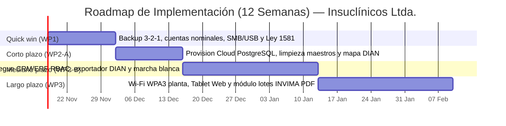

# Plan de Implementación (Roadmap de Transición)

## Cliente
**Insuclínicos Ltda.** — Fabricación y comercialización de prendas e insumos médicos quirúrgicos desechables en tela no tejida SMS (Bogotá D.C., Colombia · 6 empleados multifunción · ~40 clínicas, consultorios odontológicos y spas).

## Integrantes del equipo (Grupo 8)
- **Jorge Steven Doncel Bejarano** (`@gevengood` · [jorgedobe@unisabana.edu.co](mailto:jorgedobe@unisabana.edu.co))
- **David Santiago Buendia Londoño** (`@Santiagoob7` · [davidbulo@unisabana.edu.co](mailto:davidbulo@unisabana.edu.co))

## Propósito de este documento

Se implementará una plataforma **CRM/ERP ligera en la nube (Odoo / Dolibarr Cloud sobre PostgreSQL)** conectada a un exportador CSV de facturación electrónica DIAN, una **Tablet Web en planta** con registro obligatorio de lotes INVIMA y un endurecimiento previo de **copias 3-2-1, cuentas nominales y cumplimiento Ley 1581**, con presupuesto acotado (`~$2.200.000 COP/año`, por debajo del tope de `$3.000.000 COP/año`). Sin un plan secuenciado por fases y gestión del cambio, el diseño TO-BE quedaría en papel porque una microempresa de 6 trabajadores no puede detener su producción ni sus despachos para hacer un reemplazo abrupto de sus libros de Excel.

---

## Fases de implementación

Las fases traducen los paquetes de trabajo definidos en el Taller 7 (`WP1`, `WP2`, `WP3` a lo largo de **12 semanas**) al esquema ejecutable de 4 etapas de transición (`Quick win`, `Corto plazo`, `Mediano plazo`, `Largo plazo`), trazando cada etapa directamente a los riesgos consolidados en [`matriz-riesgos.xlsx`](matriz-riesgos.xlsx) y a las brechas `GAP-01` a `GAP-10` de [`../07-opportunities-solutions/matriz-brechas.xlsx`](../07-opportunities-solutions/matriz-brechas.xlsx). Cada fase equivale exactamente a un `Work Package` en la vista ArchiMate de migración ([`vistas-finales/archimate-migracion.drawio`](vistas-finales/archimate-migracion.drawio)).

| Fase | Qué se implementa | Riesgo / brecha que corrige | Esfuerzo (Bajo/Medio/Alto) | Duración estimada | Responsable sugerido |
|---|---|---|---|---|---|
| **Quick win** (`WP1`) | Copias automáticas diarias bajo regla **3-2-1** en nube cifrada, **6 cuentas nominales Windows** (bloqueo 5 min), cierre de carpetas SMB abiertas, restricción de puertos USB, aviso automático **Ley 1581** en WhatsApp Business y buzón ARCO (`contacto@insuclinicos.com`). | **`R3`** (`SPOF` disco duro local / ransomware `T5`), **`R5`** (incumplimiento Ley 1581) y **`R6`** (`T1` suplantación, `T4` fuga USB, `T6` carpetas LAN) — Brechas `GAP-03`, `GAP-06`, `GAP-08`, `GAP-10`. | Bajo | Semanas 1–2 (14 días) | Representante Legal / DPO (Santiago Martínez) y Asesor Técnico |
| **Corto plazo** (`WP2-A`) | Aprovisionamiento de instancia Cloud gestionada (**PostgreSQL Multi-AZ** + CRM/ERP), limpieza y deduplicación del catálogo de **~40 clínicas** y saldos reales de rollos SMS, y definición del esquema CSV para carga en el portal DIAN. | **`R8`** (datos maestros duplicados y saldos inconsistentes al migrar) y prepara **`R7`** (eliminación de doble digitación DIAN) — Prepara `GAP-01` y `GAP-02`. | Bajo | Semanas 3–4 (14 días) | Asesor Técnico, Auxiliar Comercial y Encargado de Almacén |
| **Mediano plazo** (`WP2-B`) | Puesta en marcha del **CRM/ERP Cloud** (módulos Comercial, Inventario concurrente SMS, Seguridad RBAC y bitácora inmutable `audit_log`), **exportador CSV DIAN** y marcha blanca paralela de 1 semana retirando ambos archivos de Excel locales. | **`R1`** (silos Excel y bloqueos diarios de lectura/escritura), **`R2`** (alteración de stock/precios y repudio `T2`/`T3`) y **`R7`** (doble digitación DIAN) — Brechas `GAP-01`, `GAP-02`, `GAP-04`, `GAP-07`. | Medio | Semanas 5–8 (28 días) | Asesor Técnico, Auxiliar Ventas/Admin. y Encargado de Almacén |
| **Largo plazo** (`WP3`) | Cobertura **Wi-Fi WPA3** en la zona de confección, despliegue de **Tablet Web en planta** con rol restringido, obligatoriedad de campo `lote_sms_invima` al cerrar órdenes y generación de **Remisión Digital PDF** con lote estampado (cero papel). | **`R4`** (trazabilidad incompleta ante Tecnovigilancia INVIMA Dec. 4725/2005 y Res. 4816/2008) y **`R7`** (transporte físico en papel) — Brechas `GAP-05`, `GAP-09`. | Medio | Semanas 9–12 (28 días) | Jefe de Producción / Calidad y Asesor Técnico |

> **Criterio de secuenciación (Prioridad de Riesgo × Esfuerzo):** Aunque **`R1`** y **`R2`** (silos Excel y manipulación sin bitácora) tienen **Nivel `9` (Prioridad 1)**, su remediación definitiva exige esfuerzo **Medio** (parametrización cloud, limpieza de datos y capacitación sin detener entregas), por lo que no pueden ejecutarse como *quick win*. Se comienza protegiendo la continuidad y el cumplimiento urgente en **Semanas 1–2 (`R3`, `R5`, `R6`)** con costo marginal casi nulo mientras se sanean los maestros en **Semanas 3–4** antes del corte productivo en **Semanas 5–8** y del cierre sanitario en planta en **Semanas 9–12**.  
> Los riesgos **`R9`** (*dependencia de internet local y equipo multifunción*, Nivel `3`) y **`R10`** (*fallo físico temporal de PC cliente sin hardware espejo*, Nivel `2` — aceptado explícitamente) se gestionan mediante **`Gobernanza / cambios`** (plan de respaldo móvil 4G/5G, SLA del proveedor cloud y seguimiento trimestral en [`procedimiento-cambios.md`](procedimiento-cambios.md)) en lugar de crear una fase técnica adicional.

---

## Línea de tiempo

El cronograma completo abarca **12 semanas continuas** a partir de la aprobación formal en comité (`18 de noviembre de 2026`), garantizando el blindaje inmediato (`Quick win`) antes del pico comercial de diciembre de 2026 señalado en el Taller 7 y completando la transición integral en febrero de 2027 sin parar un solo turno de producción.

---

## Dependencias entre fases

1. **`Corto plazo (WP2-A)` depende de `Quick win (WP1)`:** antes de limpiar e importar las bases reales de ~40 clínicas y precios hacia la nube, deben existir la Política de Tratamiento de Datos aprobada por gerencia (Ley 1581) y el respaldo base 3-2-1 sobre los archivos originales para evitar pérdida durante la depuración.
2. **`Mediano plazo (WP2-B)` depende de `Corto plazo (WP2-A)`:** el go-live del CRM/ERP requiere obligatoriamente saldos iniciales auditados de rollos SMS, catálogo de prendas normalizado sin duplicados (`R8`) y validación del formato CSV exigido por el proveedor de Facturación Electrónica DIAN.
3. **`Largo plazo (WP3)` depende de `Mediano plazo (WP2-B)`:** la Tablet de planta consulta órdenes de producción y descuenta lotes de `MATERIA_PRIMA` sobre el módulo de inventario ya estabilizado en PostgreSQL; además exige la verificación previa de señal Wi-Fi WPA3 en la zona de corte y confección.

---

## Gestión del cambio con las personas

Insuclínicos Ltda. opera con **6 trabajadores** que cumplen funciones cruzadas entre administración, bodega y confección. No se inventan áreas inexistentes; el plan interviene directamente sobre los roles reales cuyo trabajo diario cambia:

| Grupo | Qué pierde o teme | Resistencia esperada | Poder / interés (Alto / Medio / Bajo) | Comunicación y capacitación | Cuándo | Responsable |
|---|---|---|---|---|---|---|
| **Operarios de corte, confección y calidad (Planta — 2 a 3 personas)** *(trabajo que cambia: papel → Tablet)* | Temen retrasarse en la máquina al llenar formularios digitales y quedar expuestos ante errores de consumo de tela o reprocesos. | Seguir anotando órdenes en cuadernos o papel suelto "por si acaso" y omitir el número de lote del rollo SMS cuando haya afán. | Poder: Bajo · Interés: Alto | Reunión en planta explicando que la Tablet sustituye buscar planillas perdidas; taller práctico de **90 min** simulando 3 órdenes completas y escaneo/selección del lote SMS antes de encender el bloqueo obligatorio. | Semanas 9–10 (inicio de `WP3`) | Jefe de Producción y Asesor Técnico |
| **Auxiliar de Ventas y Administración (Oficina — 1 a 2 personas)** *(deja Excel de Pedidos y chat sin control)* | Pierde sus fórmulas personales en Excel y teme que el aviso Ley 1581 incomode a clientes frecuentes en WhatsApp o que el exportador CSV atrase las facturas DIAN. | Mantener un "Excel paralelo oculto" para cotizar "más rápido", volviendo a generar silos y doble digitación. | Poder: Medio · Interés: Alto | Demostración lado a lado comparando cotización en CRM vs Excel; **2 sesiones prácticas de 60 min** sobre flujo comercial, aviso automático WhatsApp y descarga CSV DIAN; archivo solo-lectura de Excels antiguos tras marcha blanca. | Semanas 5–7 (durante `WP2-B`) | Asesor Técnico |
| **Encargado de Almacén y Despacho (Bodega — 1 persona)** *(deja Excel de Inventario y remisiones manuales)* | Teme quedar responsable de descuadres históricos entre los rollos físicos y el sistema, o no poder despachar rápido ante faltantes urgentes. | Hacer ajustes manuales globales sin soporte o posponer el conteo de ingresos de rollos SMS. | Poder: Medio · Interés: Alto | Participación directa en el conteo y saneamiento de inventario inicial (Semanas 3–4) + práctica guiada de entrada de rollos con lote y generación de Remisión Digital PDF. | Semanas 3–4 (`WP2-A`) y Semana 8 | Encargado de Almacén y Gerencia |
| **Representante Legal (Santiago Martínez — Gerencia / DPO)** | Teme superar el presupuesto anual (`$3.000.000 COP/año`), interrumpir entregas a clínicas clave o cargar con trámites burocráticos complejos. | Postergar decisiones por falta de tiempo operativo si los reportes son demasiado técnicos o extensos. | Poder: Alto · Interés: Alto | Acta quincenal ejecutiva de **1 página** mostrando riesgos cerrados, ejecución presupuestal real y prueba en vivo del resultado visible de cada fase. | Al cierre de cada quincena (Semanas 2, 4, 6, 8, 10, 12) | Comité Ligero de Arquitectura |

### Resultado visible por fase

Cada fase concluye únicamente cuando alguien del negocio (fuera de TI) comprueba en la operación real el siguiente resultado:

| Fase | Resultado visible | Quién lo comprueba (fuera de TI) |
|---|---|---|
| **Quick win** (`WP1`) | Prueba real de restauración de un archivo operativo desde el respaldo cloud 3-2-1 en menos de 15 min, y recepción automática del aviso de privacidad **Ley 1581** al escribir por WhatsApp desde un número externo. | Representante Legal / DPO (Santiago Martínez) |
| **Corto plazo** (`WP2-A`) | Catálogo maestro depurado de las ~40 clínicas y saldos físicos verificados de rollos SMS cargados sin duplicados ni descuadres en la BD de pruebas. | Encargado de Almacén y Auxiliar Comercial |
| **Mediano plazo** (`WP2-B`) | Una semana completa de operación registrando cotizaciones y descontando inventario concurrentemente desde Ventas y Almacén con **cero bloqueos de "Solo lectura"**, cargando facturas a DIAN desde el CSV exportado sin redigitar. | Auxiliar de Ventas y Administración |
| **Largo plazo** (`WP3`) | Simulacro cronometrado de alerta sanitaria: a partir de un número de lote SMS ingresado, se identifica en **menos de 2 minutos** el listado exacto de órdenes, prendas y clínicas despachadas junto con sus Remisiones Digitales PDF, sin abrir archivadores de papel. | Responsable de Calidad y Representante Legal |

---

## Referencias

1. The Open Group. (2022). *The TOGAF® Standard, 10th Edition — Phase E (Opportunities & Solutions) and Phase F (Migration Planning)*.
2. Kotter, J. P. (1996). *Leading Change*. Harvard Business School Press. (Principio de construcción de urgencia y victorias tempranas verificables por el negocio).
3. Ministerio de la Protección Social & INVIMA. (2005 / 2008). *Decreto 4725 de 2005 y Resolución 4816 de 2008 (Programa Nacional de Tecnovigilancia)*.
4. Entregables previos del proyecto Insuclínicos Ltda.: [`../04-infraestructura/informe.md`](../04-infraestructura/informe.md), [`../05-seguridad-stride/informe.md`](../05-seguridad-stride/informe.md), [`../06-normatividad/informe.md`](../06-normatividad/informe.md), [`../07-opportunities-solutions/mejora-arquitectura.md`](../07-opportunities-solutions/mejora-arquitectura.md) y [`matriz-riesgos.xlsx`](matriz-riesgos.xlsx).

---

_Este documento hace parte de la entrega final del Taller 9 del curso AREM (Arquitectura Empresarial) - Universidad de La Sabana._
